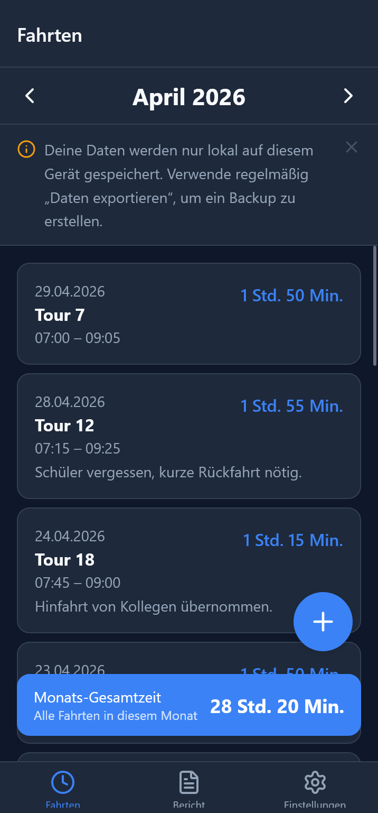
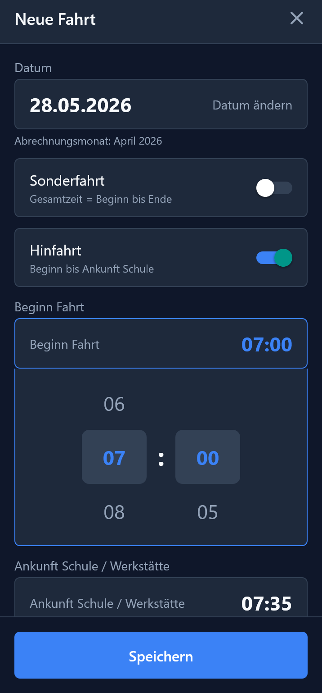
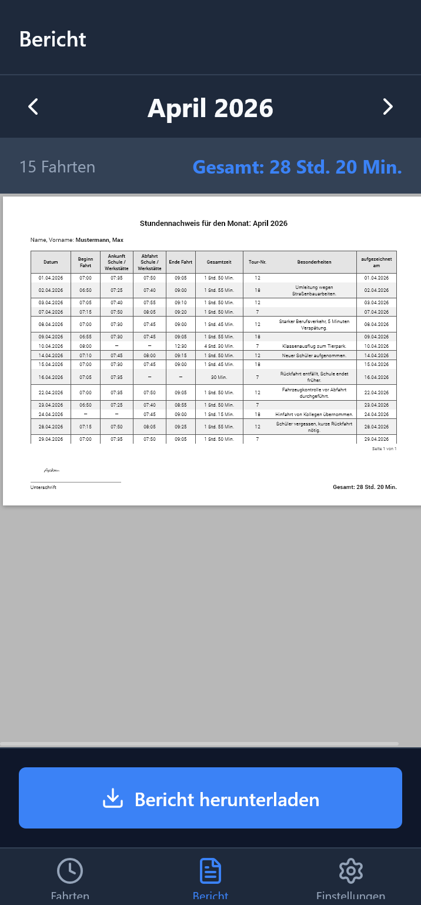
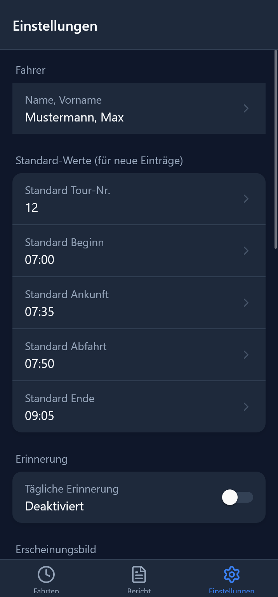

# Stundennachweis

**A digital timesheet app for German school bus drivers. Log each trip in under 30 seconds and send a signed monthly PDF report at the end of the month. No paper and no backend.**

[](https://stundennachweis-app.web.app)
[](https://github.com/arpkan/stundennachweis/actions/workflows/ci.yml)


-555)

<p align="center">
  
  &nbsp;
  
  &nbsp;
  
  &nbsp;
  
</p>
<p align="center"><em>Trip list · Trip entry · Monthly report · Settings — <a href="https://stundennachweis-app.web.app">try the live demo</a></em></p>

---

## The problem

School bus and workshop shuttle drivers in Germany record their working hours on a paper form called the *Stundennachweis*. Every day they write down when they started, when they arrived at the school, when they left and when they finished. At the end of the month they add up the hours by hand, sign the form and hand it in to their company, which uses it to pay them.

This takes time, the arithmetic is error-prone, and the form is easy to lose.

## The solution

Stundennachweis replaces the paper form with an app built for the way drivers actually work: entering times **from memory at the end of the day**, often in a vehicle cab, without being tech-savvy.

- **Log a trip in seconds.** Times are picked with large scroll wheels that move in 5-minute steps. Defaults come from your settings or from what you drove on the same weekday before.
- **Hours are calculated for you.** Total time (*Gesamtzeit*) is worked out automatically, so you never type it in.
- **One-tap monthly report.** The app creates an A4 landscape PDF that matches the original paper form column for column, with your digital signature and the monthly total.
- **Send it any way you like.** Email, WhatsApp or anything else, through the phone's normal share menu.
- **Works fully offline.** All data stays on the device. There is no account, no server and no tracking.

The company that receives the report doesn't need to change anything: the PDF looks like the paper form they already know.

---

## Features

| | |
|---|---|
| **Trip entry** | Scroll-wheel time pickers (5-minute steps), last 3 tour numbers as quick-tap chips, collapsible notes field (*Besonderheiten*) |
| **Four trip types** | Full trip, outbound only (*Hinfahrt*), return only (*Rückfahrt*), and special trips (*Sonderfahrt*), each with its own total-time formula |
| **Report month** | A trip can be assigned to a different report month than its date, e.g. a trip on 1 May that belongs to the April report |
| **Smart defaults** | Pre-filled in this order: your settings, then your history for the same weekday, then built-in defaults |
| **Monthly list** | Trips grouped by month, with swipe-to-delete and a running total |
| **PDF report** | A4 landscape, serif font, the same column layout as the paper form, signature image and monthly total in the footer, page breaks for long months |
| **Digital signature** | Signed once in landscape and stored on the device |
| **Backup and restore** | Export everything as a JSON file through the share menu and import it again with a file picker, with a preview before import |
| **Daily reminders** | Local notification at a time you choose (native app only) |
| **Installable web app** | The same codebase runs in the browser as an installable PWA with offline support |

### Total-time (*Gesamtzeit*) calculation

| Trip type | Formula |
|---|---|
| Full trip | `(Arrival at school − Start) + (End − Departure from school)` |
| Outbound only | `Arrival at school − Start` |
| Return only | `End − Departure from school` |
| Special trip | `End − Start` |

The formula is chosen from which time fields are filled in, so the driver never picks it manually. See [`utils/format.ts`](utils/format.ts).

---

## Tech stack

| Area | Technology |
|---|---|
| Framework | [Expo](https://expo.dev) SDK 54, React Native 0.81 (New Architecture), React 19, TypeScript |
| Navigation | `expo-router` (file-based, tabs plus modal) |
| Storage | `expo-sqlite` on iOS and Android; `sql.js` (SQLite compiled to WebAssembly) saved to IndexedDB on web |
| PDF | `pdfmake` for the PDF, an HTML template in a WebView for the live preview |
| UI | NativeWind (Tailwind), `lucide-react-native` icons, Reanimated 4, Gesture Handler |
| Device features | `expo-sharing`, `expo-document-picker`, `expo-notifications`, `expo-screen-orientation`, `react-native-signature-canvas` |
| CI/CD | GitHub Actions builds an iOS IPA (macOS runner) and a signed Android APK on every push to `main` |
| Web hosting | Firebase Hosting (PWA with service worker and web app manifest) |

---

## Architecture highlights

### One codebase for iOS, Android and web

Every native-only API sits behind a small wrapper in [`utils/platform/`](utils/platform). Each wrapper has a native version (`*.ts`) and a web version (`*.web.ts`), and Metro picks the right one at build time:

```
utils/platform/
  storage.ts / storage.web.ts                  expo-sqlite  ↔  sql.js + IndexedDB
  sharing.ts / sharing.web.ts                  share sheet  ↔  Web Share API / download
  signature.tsx / signature.web.tsx            native canvas  ↔  signature_pad
  document-picker.ts / document-picker.web.ts
  filesystem.ts / filesystem.web.ts
  notifications.ts / notifications.web.ts
  orientation.ts / orientation.web.ts
  date-picker.tsx / date-picker.web.tsx
```

On the web, [`db/web-database.tsx`](db/web-database.tsx) provides the **same interface as `expo-sqlite`** on top of `sql.js` and saves the database to IndexedDB shortly after each write. Because of this, the data layer ([`db/queries.ts`](db/queries.ts), [`db/schema.ts`](db/schema.ts)) and all screens have no web-specific code.

### Project structure

```
app/
  (tabs)/
    index.tsx           Home: monthly trip list
    bericht.tsx         Report: PDF preview and sharing
    einstellungen.tsx   Settings: driver, signature, defaults, backup, reminders
  entry/[id].tsx        Add or edit a trip (full-screen modal)
components/ui/          Reusable building blocks (DrumColumn, TimeField, TourChips, SignaturePad, ...)
db/                     Schema, migrations, typed queries, web SQLite adapter
utils/                  Time maths, PDF generation, backup, notifications, platform wrappers
tests/                  Unit tests (Node's built-in test runner)
theme.ts                Design tokens (colours, typography, spacing)
```

### Design principles

The app was designed for drivers aged 30 to 60 who aren't assumed to be tech-savvy (see [`DESIGN.md`](DESIGN.md) and [`PRD.md`](PRD.md)):

- **Minimum 16 pt text and 48 dp tap targets**, so it's usable in a vehicle cab
- **No keyboard for times**, only scroll wheels
- **Errors shown next to the field**, never pop-up alerts
- **All colours, sizes and spacing come from `theme.ts`**, never hard-coded in screens
- **German throughout the interface**, with German date and time formats (`DD.MM.YYYY`, `HH:MM`, `X Std. Y Min.`)

---

## Getting started

**Requirements:** Node.js 22+, and either Xcode (iOS) or Android Studio (Android) for native builds.

```bash
git clone https://github.com/arpkan/stundennachweis.git
cd stundennachweis
npm install

npx expo start            # development server (press i / a / w for iOS / Android / web)
npx expo run:ios          # native iOS build on the simulator
npx expo run:android      # native Android build on the emulator
```

Other useful commands:

```bash
npm test                  # unit tests (total-time maths, German date and duration formats)
npm run lint              # ESLint (Expo config)
npx tsc --noEmit          # type check
npm run build:web         # static web export to dist/
```

To try the app with example data, import [`sample-backup.json`](sample-backup.json) under **Einstellungen → Daten importieren**. It contains two months of trips (April and May 2026) for the fictional driver "Max Mustermann", including a special trip and half-day trips.

---

## Development process

The product was specified before any code was written:

- [`PRD.md`](PRD.md): target users, success criteria, scope and what the app deliberately does **not** do
- [`DESIGN.md`](DESIGN.md): design tokens, tap-target rules, a layout spec for each screen and interaction patterns
- [`docs/`](docs): design documents for larger features such as PWA support

The app was built with AI coding assistants. The spec documents above, together with the assistant instruction files ([`CLAUDE.md`](CLAUDE.md), [`AGENTS.md`](AGENTS.md), [`GEMINI.md`](GEMINI.md)), set the rules every generated change had to follow.

Features were then added in small, focused commits, for example half-day trips, special trips and assigning trips to a different report month.

---

## Roadmap ideas

- Export to CSV or Excel for the company's payroll
- Multiple drivers on one device
- Optional encrypted cloud backup

---

## Author

**arpkan**: [GitHub](https://github.com/arpkan)

---

## License

[MIT](LICENSE)
